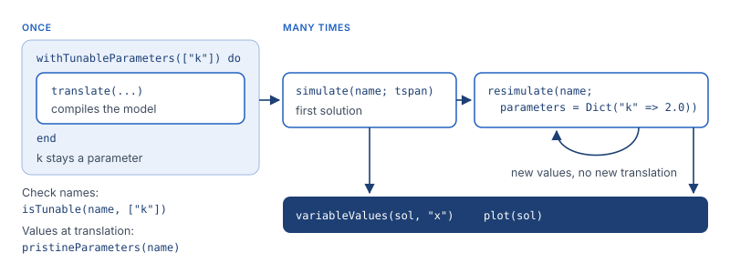

# Getting started

## Installation

The packages are in the OpenModelica registry. Add it once per Julia depot, then
install:

```julia
import Pkg
Pkg.Registry.add("General")
Pkg.Registry.add(Pkg.RegistrySpec(url = "https://github.com/OpenModelica/OpenModelicaRegistry.git"))
Pkg.add("OMBackend")
```

To translate Modelica source add OMFrontend as well (`Pkg.add("OMFrontend")`):
loading it loads the extension that connects the two.

## Example

Given a Modelica model in `BouncingBallReals.mo`, flatten it with OMFrontend.jl,
pass the flat model and its functions to `OMBackend.translate`, then simulate:

```modelica
model BouncingBallReals
  parameter Real e = 0.7;
  parameter Real g = 9.81;
  Real h(start = 1);
  Real v;
equation
  der(h) = v;
  der(v) = -g;
  when h <= 0 then
    reinit(v, -e * pre(v));
  end when;
end BouncingBallReals;
```

```julia
begin
  import OMFrontend, OMBackend
  scode = OMFrontend.translateToSCode(OMFrontend.parseFile("BouncingBallReals.mo"))
  (fm, cache) = OMFrontend.instantiateSCodeToFM("BouncingBallReals", scode)
  OMBackend.translate(fm; functionList = OMFrontend.cacheToFunctionList(cache))
  sol = OMBackend.simulate("BouncingBallReals"; tspan = (0.0, 2.5))
  OMBackend.variableValues(sol, "h")
end
```

## Translate once, simulate many times



A parameter named in [`OMBackend.withTunableParameters`](@ref) stays a parameter
of the compiled model. [`OMBackend.resimulate`](@ref) then solves the model with
new values without a new translation:

```julia
begin
  OMBackend.withTunableParameters(["e"]) do
    OMBackend.translate(fm; functionList = OMFrontend.cacheToFunctionList(cache))
  end
  OMBackend.isTunable("BouncingBallReals", ["e"])  # true
  sol = OMBackend.resimulate("BouncingBallReals"; tspan = (0.0, 2.5),
                             parameters = Dict("e" => 0.5))
end
```

`examples/` in the repository has more models and `examples/simulate_examples.jl`
runs them.

## Documentation in the REPL

Every function of the [API reference](api.md) has its docstring in Julia's help
mode, for example `?OMBackend.simulate`.

## Tests

```julia
import Pkg
Pkg.test("OMBackend")
```
