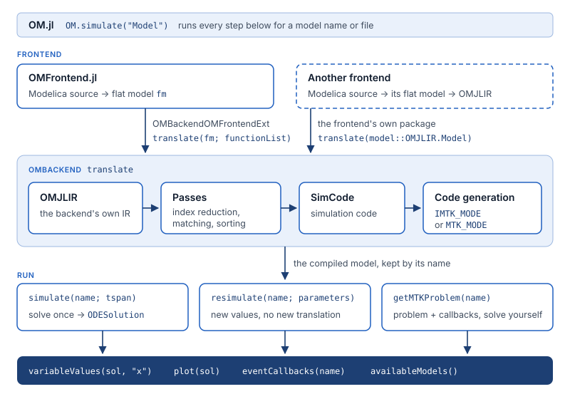

```@meta
CurrentModule = OMBackend
```

# OMBackend.jl

OMBackend.jl is one component of OMJL, the Modelica compiler infrastructure for
Julia. It takes a model in its own intermediate representation, OMJLIR, runs its
passes there, generates the simulation code, and from it a system that is
simulated with DifferentialEquations.jl and ModelingToolkit.jl.

## Pipeline



| Step | Where in the repository |
|:---|:---|
| The model as OMJLIR | `src/IR` |
| Passes on OMJLIR (index reduction, matching, sorting) | `src/Backend/Passes` |
| Simulation code (SimCode) | `src/SimCode` |
| Code generation for ModelingToolkit.jl and DifferentialEquations.jl, and the runtime | `src/CodeGeneration` |
| The user-facing functions (this reference) | `src/backendAPI.jl` |

## Frontends

The backend does not depend on a frontend. It takes a model in OMJLIR:

| Frontend | Load | Call |
|:---|:---|:---|
| [OMFrontend.jl](https://github.com/OpenModelica/OMFrontend.jl), in Julia | `import OMFrontend`: Julia loads the package extension `OMBackendOMFrontendExt`, which lowers OMFrontend's flat model to OMJLIR | `OMBackend.translate(fm; functionList = ...)`, see [Getting started](getting-started.md) |
| Another frontend | its own package, which lowers its flat model to OMJLIR | `OMBackend.translate(model::OMJLIR.Model)` |

On both routes [`OMBackend.simulate`](@ref) then runs the model by name.

## Where to read next

* [Getting started](getting-started.md): installation and an example.
* [API reference](api.md): translate, simulate, inspect and clear models.
* [OM.jl](https://github.com/JKRT/OM.jl) is the user-level package built on
  OMFrontend.jl and OMBackend.jl: `OM.simulate` runs the whole chain.
